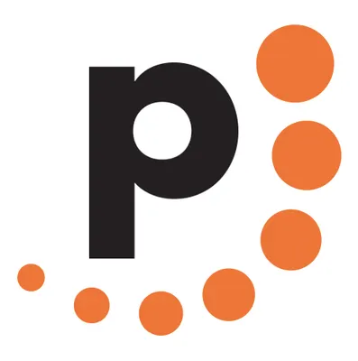

# Analyse du domaine — Prénom Nom

## Découverte de soi

- Mes forces : créativité, persévérance et curiosité
    - Exemple : J'ai dû recommencer un travail deux fois à cause que je l'avais perdu, deux fois
- Mes faiblesses ou points à améliorer : manque d'organisation, mauvaise gestion du temps et l'impatience
    - Exemple : Je ne sais rarement où commencer quand je commence un projet et je fais toujours les travaux à la dernière minute
- Seul(e) ou en équipe : équipe
    - Pourquoi et exemple : Plus d'idée et simple pour la majorité. J'avais un travail à faire en équipe et on a pu se séparer la tâche
- Plutôt technique ou créatif : créatif

## Exploration des domaines

| Domaine | Intérêt | Pourquoi |
|---|---|---|
| Graphisme | fort | Le graphisme est un de mes points forts et c'est un domaine que j'apprécie beaucoup |
| Vidéo et animation 2D | fort | Ceci est quelque chose que je fais ça fais un bon bout de temps, que j'apprécie beaucoup aussi|
| 3D | faible | Je n'ai pas encore exploré ce domaine assez pour être intéressé |
| Web | moyen | Je commence et je trouve que c'est correct même si mon savoir sur ce domaine est faible |
| Jeux vidéo | moyen | Malgré que j'aime beaucoup les jeux vidéo, je ne me vois pas a en faire un pour le moment, du tout |
| Développement logiciel | faible | Je trouve ce domaine compliqué et il y a beaucoup d'informations à retenir |
| Installations et expériences immersives | faible | ce domaine ne m'interesse pas pour l'instant |

## Mes 2 domaines préférés

### Domaine 1 : Graphisme

- Expérience : projets personelle, loisir et passe-temps
- Logiciels et outils : je connais krita, clip studio paint, photoshop, ibis paint. J'aimerais utuliser procreate (pour Ipad) et Illustrator plus tard aussi
- Pourquoi il m'intéresse : C'est quelque chose que je fais ça fait longtemps, et ça m'a toujours intéressé
- Travailler dans ce domaine : oui, puisque je veux travailler dans un domaine que je vais avoir du plaisir et ne pas m'ennuyer

### Domaine 2 : Vidéo et animation 2D

- Expérience : projets personelle, loisir
- Logiciels et outils : webtoonz, krita, alight motion, ibis painr
- Pourquoi il m'intéresse : je trouve que faire de l'animation 2D rend mon imagination vraie, avec beaucoup de possibilités
- Travailler dans ce domaine : non, je ne vais sûrement pas avoir de motivation à animer quelque chose qui n'est pas dans mon champ d'intérêt

## Les caractéristiques de mon domaine préféré

- Types d'entreprises : Studios de création, agences de communication et de design, etc
- Exemple d'entreprise : Pro-Actif, Graphissimo, etc

(source de l'image : https://www.pro-actif.ca/)

- Types de produits et de services : conception graphique, mise en page de rapports annuels, etc
- Étapes de production : Idéation / recherche, préproduction, et production
- Type d'emploi visé : Graphiste
- Étapes pour obtenir cet emploi : D.E.C. en graphisme, avoir des connaissance sur photoshop/illustrator, avoir un portfolio

## Conclusion

- Mon profil en une phrase : Je suis quelqu'un de créatif et curieux qui veut travailler dans le graphisme
- Ce qui m'a surpris : je connais plus d'applications pour le dessin et l'animation que je ne mentionne presque jamais
- Ma force principale et la faiblesse à travailler : Ma créativité va m'aider beaucoup dans mon emploi visé. Je vais devoir travailler mon organisation le plus
- Mon action d'ici la fin de la session : Je veux faire plusieurs dessins et en faire des affiches pour ma chambre, j'aimerais terminer ça pour avant Noël.

## Ma capsule

)
